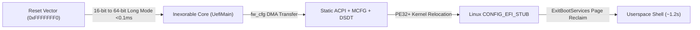

# Inexorable

<div align="center">

[](https://www.osfc.io/2026/talks/minimalist-uefi-implementation-for-virtual-machines/)


**Minimal Standalone UEFI Firmware for Virtual Machines (x86_64)**

</div>

---

**Inexorable** is a minimalist, standalone UEFI firmware for x86_64 virtual machines with static hardware topologies (such as QEMU). It bypasses firmware-side dynamic hardware discovery, legacy bus scanning, and EDK2 driver dispatch by transitioning directly from the reset vector into 64-bit long mode, constructing static ACPI/PCIe descriptors, and transferring execution directly to a Linux kernel via `CONFIG_EFI_STUB`.

Originally presented at the [**Open Source Firmware Conference (OSFC) 2026**](https://www.osfc.io/2026/talks/minimalist-uefi-implementation-for-virtual-machines/), Inexorable replaces the multi-phase PEI/DXE initialization sequence of standard UEFI implementations with deterministic static configuration. It executes in **~31 ms** of in-guest firmware time (compared to **~570–640 ms** for EDK2 / OVMF) with a freestanding binary footprint of **30 KB** (~3,140 LOC).

---

## Table of Contents

- [Motivation & Design](#motivation--design)
- [Documentation Suite](#documentation-suite)
- [Key Architectural Features](#key-architectural-features)
  - [1. Reset Vector to Long Mode](#1-reset-vector-to-long-mode)
  - [2. Standalone Freestanding Core](#2-standalone-freestanding-core)
  - [3. Static ACPI & PCIe MCFG Topology](#3-static-acpi--pcie-mcfg-topology)
  - [4. Deterministic Page Allocator & Memory Reclaim](#4-deterministic-page-allocator--memory-reclaim)
  - [5. fw_cfg DMA & LINUX_EFI_INITRD_MEDIA_GUID](#5-fw_cfg-dma--linux_efi_initrd_media_guid)
  - [6. RDRAND-Backed EFI_RNG_PROTOCOL](#6-rdrand-backed-efi_rng_protocol)
- [Performance Benchmarks](#performance-benchmarks)
- [Physical Memory Layout](#physical-memory-layout)
- [Tooling & Test Harness](#tooling--test-harness)
- [Repository Structure](#repository-structure)
- [Prerequisites & Toolchain](#prerequisites--toolchain)
- [Building & Running](#building--running)
  - [Cross-Platform Makefile](#cross-platform-makefile)
  - [Visual Studio 2022 Solution](#visual-studio-2022-solution)
- [License & Commercial Inquiries](#license--commercial-inquiries)

---

## Motivation & Design

Standard virtual machine firmware (such as EDK2 / OVMF) executes through five physical PC legacy phases:

```text
[SEC (16-bit Reset)] ➔ [PEI (32-bit Init)] ➔ [DXE (Driver Dispatch)] ➔ [BDS (Boot Select)] ➔ [OS Loader]
```

During this sequence, OVMF dynamically probes storage controllers, ATA/IDE buses, legacy keyboards, and option ROMs, incurring **500 to 650 ms** of firmware initialization before the operating system kernel starts.

Modern cloud hypervisors (such as AWS Firecracker) avoided firmware altogether by implementing direct-kernel boot protocols (loading uncompressed `vmlinux` directly via PVH or 64-bit boot protocols) specifically to eliminate this firmware overhead. However, when a standard UEFI boot handoff (`CONFIG_EFI_STUB`) or runtime ACPI/SMBIOS infrastructure is desired without discarding firmware boundaries, full EDK2 distributions reintroduce unnecessary probing overhead.

In virtual machines with static topologies, hardware is predetermined and paravirtualized. Inexorable replaces the dynamic driver dispatcher with static table generation and direct long-mode execution:



---

## Key Architectural Features

### 1. Reset Vector to Long Mode
- Implemented in [`qemu_target/reset_vector.asm`](qemu_target/reset_vector.asm).
- Placed directly at `0xFFFFFFF0` in the 2MB ROM image (`inexorable.fd`).
- Configures CR4 (enabling PAE, OSFXSR, OSXMMEXCPT), loads a 64-bit Global Descriptor Table (GDT), establishes 4-level paging with 1GB identity maps, sets `EFER.LME` (Long Mode Enable), and executes a 64-bit far jump straight into [`UefiMain`](Inexorable/Main.c).

### 2. Standalone Freestanding Core
- Decoupled from external EDK2 submodules (`MdePkg`, `MdeModulePkg`, `CryptoPkg`).
- Clean EFI type definitions and memory models defined in [`include/efi_spec.h`](include/efi_spec.h) and [`include/inexorable_layout.h`](include/inexorable_layout.h).
- Compiled with standard LLVM/Clang (`clang -target x86_64-unknown-windows`) and linked with `lld-link` as a freestanding PE32+ executable.
- Core binary footprint is **30 KB** (~3,140 LOC).

### 3. Static ACPI & PCIe MCFG Topology
- Implemented in [`Inexorable/Acpi.c`](Inexorable/Acpi.c).
- Constructs minimal static ACPI 2.0+ tables directly in physical memory without dynamic DSDT bytecode generation:
  - **RSDP**: Root System Description Pointer (Revision 2).
  - **XSDT**: Extended System Description Table.
  - **FADT**: Declares ACPI power/timer registers (PM1a, PM timer) and PCI reset register (`0xCF9`).
  - **MADT**: Multiple APIC Description Table declaring Local APICs (1–64 vCPUs) and the I/O APIC (`0xFEC00000`, GSI base 0).
  - **MCFG**: PCI Express Memory-Mapped Configuration Space (ECAM) base `0xB0000000`, bus range 0–255.
  - **DSDT**: Static AML bytecode defining:
    - PCI Express Root Bridge (`PCI0`) with `_HID = PNP0A08` and `_CID = PNP0A03`.
    - Motherboard Resource Reservation (`MMCF`, `_HID = PNP0C02`) covering `0xB0000000` (256MB), satisfying Linux `pci_mmcfg_check_reserved()`.
    - PCI Routing Table (`_PRT`) mapping PCI INT A/B/C/D lines to I/O APIC GSIs 10 and 11.
- Allows PCIe paravirtualized devices (`virtio-net-pci`, `e1000e`, `virtio-blk-pci`) to bind and operate in Linux without requiring `pci=off`.

### 4. Deterministic Page Allocator & Memory Reclaim
- Implemented in [`Inexorable/Memory.c`](Inexorable/Memory.c).
- Uses a deterministic page bump allocator with adjacent range coalescing.
- Emits **16 clean EFI memory descriptors** to the operating system (compared to 48–64 fragmented descriptors in standard OVMF).
- Firmware staging buffers, QEMU fw_cfg staging areas, and kernel relocation buffers are assigned `EfiBootServicesCode` and `EfiBootServicesData`. Under standard UEFI behavior, Linux reclaims these ranges during `ExitBootServices()`, providing **~1,958 MB usable RAM** to Linux in a 2,048 MB virtual machine.

### 5. fw_cfg DMA & `LINUX_EFI_INITRD_MEDIA_GUID`
- Implemented in [`Inexorable/QemuFwCfg.c`](Inexorable/QemuFwCfg.c) and [`Inexorable/InitrdLoadFile2.c`](Inexorable/InitrdLoadFile2.c).
- Reads kernel command line, PE32+ kernel image, and initramfs via the QEMU fw_cfg DMA port (`0x514`).
- Implements `EFI_LOAD_FILE2_PROTOCOL` keyed to `LINUX_EFI_INITRD_MEDIA_GUID` (`{0x58de23aa, 0x1149, 0x47e8, {0x80, 0x2e, 0x52, 0x49, 0xa9, 0xab, 0x3a, 0x97}}`).
- The Linux kernel EFI stub (`CONFIG_EFI_STUB`) queries this protocol and streams the initramfs directly into its target memory pages using DMA without intermediate copies or virtual block devices.

### 6. RDRAND-Backed `EFI_RNG_PROTOCOL`
- Implemented in [`Inexorable/RngProtocol.c`](Inexorable/RngProtocol.c).
- Provides `EFI_RNG_PROTOCOL` wrapping the x86 hardware `rdrand` instruction (with a PRNG fallback).
- Supplies entropy to the Linux kernel EFI stub for Kernel Address Space Layout Randomization (KASLR) without boot stalls.

---

## Performance Benchmarks

Comparative benchmark results conducted under WSL2 KVM, QEMU 10.2.0, Arch Linux kernel 7.2.11 (10-run mean values):

| Metric | Inexorable | EDK2 OVMF | Notes |
|:---|:---:|:---:|:---|
| **Active Firmware Binary Size** | **30.0 KB** | 3,653.6 KB | **121× smaller** |
| **In-Guest Firmware Latency (Mean)** | **31.6 ms** | 572.1 ms | **~18× faster firmware phase** ⚡ |
| **In-Guest Firmware Latency (Min)** | **27.3 ms** | 546.7 ms | **~20× faster firmware phase** ⚡ |
| **Host FW Latency to Kernel (Mean)** | **315.9 ms** | 652.1 ms | **~2.1× faster** |
| **Linux Kernel Execution Phase** | **947.7 ms** | 978.1 ms | Identical kernel + initramfs payload |
| **Total Cold-Boot to Shell (Mean)** | **1,263.6 ms** (1.26 s) | 1,630.2 ms (1.63 s) | **~366 ms (~23%) faster overall** |
| **Total Cold-Boot to Shell (Min)** | **1,212.9 ms** (1.21 s) | 1,566.7 ms (1.57 s) | **~354 ms faster overall** |
| **Flash Image (`.fd`)** | **2,048 KB** (2 MB) | 4,096 KB (4 MB) | 2× smaller image |
| **Guest Usable Memory (2048 MB)** | **1,958 MB** | 1,894 MB | +64 MB available to OS |
| **EFI Memory Map Descriptors** | **16 descriptors** | 48–64 descriptors | Coalesced map |
| **VirtIO / PCIe Networking** | **Active** | Active | Functional out-of-the-box |

> [!NOTE]
> The ~18–20× speedup specifically measures the in-guest firmware execution window (Reset Vector to Linux kernel entry). Because Linux kernel initialization and userspace init represent the majority of overall boot latency (~950 ms), the net wall-clock improvement from QEMU spawn to shell prompt is **~350–370 ms (~23% faster cold-boot overall)**.

---

## Physical Memory Layout

Inexorable enforces a deterministic physical memory layout configured at reset:

```text
  +-----------------------+ 0xFFFFFFFF (4 GB)
  | 32-bit PCI MMIO Space | 
  +-----------------------+ 0xC0000000
  | PCIe ECAM (256 MB)    | Reserved for MCFG / Memory-Mapped Config
  +-----------------------+ 0xB0000000
  | High Conventional RAM | Reclaimable Free RAM for Guest OS
  +-----------------------+ 0x50000000
  | Staging Buffers       | Kernel, Initrd, fw_cfg DMA (Reclaimed by OS)
  +-----------------------+ 0x40100000
  | Identity Page Tables  | 4-Level Paging (PML4, PDPT, 1GB Page Directories)
  +-----------------------+ 0x40030000
  | ACPI Tables           | RSDP, XSDT, FADT, MADT, MCFG, DSDT (ACPI NVS)
  +-----------------------+ 0x40020000
  | Inexorable Core       | UefiMain, Memory Allocator, Protocols (PE32+)
  +-----------------------+ 0x40000000
  | Low Conventional RAM  | Free RAM (0x00100000 - 0x3FFFFFFF)
  +-----------------------+ 0x00100000
  | Reset Vector Tramp    | 16-bit Reset Vector at 0xFFFFFFF0 / 0x000F0000
  +-----------------------+ 0x00000000
```

---

## Tooling & Test Harness

Inexorable includes standalone build scripts and a disk-free test harness:

### 1. Flash ROM Synthesizer (`tools/build_fd.py`)
- Synthesizes the 2MB ROM image (`inexorable.fd`) required by QEMU without external EDK2 `BaseTools` or `GenFv`.
- Maps the PE32+ firmware core to `0xFFE00000` (offset `0x000000`) and the 16-bit reset vector trampoline to `0xFFFFF000` (offset `0x1FF000`).
- **Usage**: `python tools/build_fd.py`

### 2. In-Memory Test Initramfs Packager (`tools/package_rootfs.py`)
- Packages a minimal Linux initramfs (`inexorable_rootfs.img`) containing Busybox, runtime libraries, and PCIe network drivers (`virtio_net`, `e1000e`).
- **Zero Emulated Disks**: Because the initramfs is loaded directly via fw_cfg DMA and `EFI_LOAD_FILE2_PROTOCOL`, the virtual machine boots and tests networking without requiring virtual disk controllers, storage partitions, or emulated block devices (virtio-blk / AHCI / IDE).
- **Usage**: `python tools/package_rootfs.py`

### 3. Empirical Cold-Boot Benchmark Engine (`scripts/benchmark.py`)
- Measures in-guest firmware TSC cycles (`rdtsc`), host wall-clock firmware time, kernel initialization phase, and userspace PID 1 shell arrival against EDK2 / OVMF (`OVMF.4m.fd`).
- Supports configurable run counts and quick smoke testing.
- **Usage**:
  ```bash
  python scripts/benchmark.py          # Standard 10-run comparative benchmark
  python scripts/benchmark.py --quick  # Fast 3-run smoke test
  python scripts/benchmark.py --runs N # Custom N-run test
  ```

### 4. PCIe Network Verification Suite (`scripts/test_network.py`)
- Automates verification for PCI Express network controllers (`virtio-net-pci` and `e1000e`).
- Validates PCIe ECAM BAR configuration, link carrier negotiation, DHCP IP acquisition (`10.0.2.15/24`), default routing, and bi-directional ICMP ping echo with **0% packet loss**.
- **Usage**: `python scripts/test_network.py` (or `make testnet`)

---

## Repository Structure

```text
Inexorable/
├── include/                     # Standalone EFI headers
│   ├── efi_spec.h               # UEFI standard types, protocols & structs
│   └── inexorable_layout.h      # Physical memory map layout & constants
├── Inexorable/                  # Firmware source code
│   ├── Acpi.c / Acpi.h          # ACPI 2.0 tables, MCFG, and DSDT PCIe root bridge
│   ├── Boot.asm                 # Win64 low-level assembly primitives
│   ├── Efi.h                    # Core EFI subsystem linkage
│   ├── InitrdLoadFile2.c / .h   # LINUX_EFI_INITRD_MEDIA_GUID DMA provider
│   ├── Main.c                   # Firmware UefiMain entry point & boot coordinator
│   ├── Memory.c / Memory.h      # Page bump allocator & memory map coalescer
│   ├── Misc.c / Misc.h          # String routines, memory moves, and GUID comparison
│   ├── PeLoader.c / PeLoader.h  # PE32+ kernel image relocator and loader
│   ├── Protocol.c / Protocol.h  # Handle database and protocol installation
│   ├── QemuFwCfg.c / QemuFwCfg.h# QEMU fw_cfg DMA streaming interface
│   ├── RngProtocol.c / .h       # Hardware RDRAND-backed EFI RNG protocol
│   ├── Serial.c / Serial.h      # 16550 UART early debug logging (0x3F8)
│   ├── Time.c                   # EFI Runtime Services GetTime / SetTime stubs
│   ├── Variable.c / Variable.h  # EFI Runtime Variable stubs
│   ├── VirtualMemory.c          # SetVirtualAddressMap & ConvertPointer stubs
│   ├── Inexorable.vcxproj       # Visual Studio 2022 C++ Project
│   └── Inexorable.vcxproj.filters
├── docs/                        # Technical documentation suite
│   ├── index.md                 # Documentation portal
│   ├── boot-flow.md             # Execution pipeline & reset vector architecture
│   ├── what-we-strip.md         # Firmware philosophy & eliminated legacy components
│   ├── protocols.md             # Spec-compliant UEFI 2.8+ protocols & memory allocator
│   ├── acpi-and-pcie.md         # ACPI 2.0+ tables, PCIe root bridge, & MMCF reservation
│   ├── performance-analysis.md  # Latency breakdown & comparative benchmarks
│   └── tooling-and-benchmarks.md# Developer tooling & benchmark guide
├── qemu_target/                 # Hardware reset vector
│   ├── reset_vector.asm         # 16-bit Real Mode -> 64-bit Long Mode trampoline
│   └── reset_vector.bin         # Assembled binary payload
├── tools/                       # Build automation and synthesis tools
│   ├── build_fd.py              # Synthesizes 2MB inexorable.fd flash ROM
│   └── package_rootfs.py        # Generates test Linux initramfs
├── scripts/                     # Performance & network verification suite
│   ├── benchmark.py             # Automated latency benchmark against OVMF
│   ├── run_benchmark.sh         # Benchmark launcher shell script
│   └── test_network.py          # Automated PCIe network test (virtio-net & e1000e)
├── Inexorable.slnx              # Visual Studio solution file
└── Makefile                     # Cross-platform GNU Makefile
```

---

## Prerequisites & Toolchain

### Linux / WSL2 (Ubuntu / Debian / Arch / Fedora)
Install LLVM, LLD, NASM, Python 3, and QEMU:

```bash
# Arch Linux
sudo pacman -S clang lld nasm python qemu-system-x86

# Ubuntu / Debian
sudo apt-get update && sudo apt-get install -y clang lld nasm python3 qemu-system-x86
```

### Windows
- Visual Studio 2022 (with ClangCL toolset and Desktop C++ workload)
- [NASM for Windows](https://www.nasm.us/) (added to `PATH`)
- Python 3.10+
- QEMU for Windows (or run under WSL2)

---

## Building & Running

### Cross-Platform Makefile

Build the firmware, generate the test initramfs, launch QEMU, and execute automated tests:

```bash
# 1. Build Inexorable.efi and assemble inexorable.fd
make

# 2. Package the in-memory test initramfs
make rootfs

# 3. Launch Linux virtual machine under QEMU with KVM and VirtIO networking (1 CPU)
make run

# 4. Launch Linux virtual machine with 4 SMP cores
make runsmp

# 5. Launch with Verbose Firmware Telemetry & Debug Logging (1 CPU)
make rundbg

# 6. Launch with 4 SMP cores, Verbose Firmware Telemetry & Debug Logging
make runsmpdbg

# 7. Execute automated PCIe network verification (virtio-net & e1000e ping test)
make testnet

# 8. Execute the automated performance benchmark suite vs OVMF
make benchmark

# 9. Clean intermediate objects and output binaries
make clean
```

### Visual Studio 2022 Solution

1. Open [`Inexorable.slnx`](Inexorable.slnx) in Visual Studio 2022.
2. Select **Release** and **x64** target platform.
3. Build the solution (`Ctrl + Shift + B`).
4. Visual Studio invokes `ClangCL` and `NASM` to compile [`Inexorable.efi`](Inexorable/x64/Release/Inexorable.efi).
5. Run `python tools/build_fd.py` to synthesize `inexorable.fd`.

---

## Documentation Suite

Comprehensive technical documentation is organized in the [`docs/`](docs/index.md) directory:

- [**Architecture & Boot Flow**](docs/boot-flow.md): Step-by-step execution from hardware reset (`0xFFFFFFF0`) to userspace shell.
- [**What We Strip (Firmware Philosophy)**](docs/what-we-strip.md): Analysis of traditional UEFI overhead and eliminated legacy components.
- [**EFI Subsystem & Protocols**](docs/protocols.md): How Inexorable implements memory services, `LOAD_FILE2` zero-copy DMA, hardware RNG, and system tables without EDK2.
- [**ACPI & PCIe Architecture**](docs/acpi-and-pcie.md): MCFG ECAM handoff, DSDT AML root bridge, motherboard reservations (`PNP0C02`), and S5 poweroff.
- [**Deep Performance Analysis**](docs/performance-analysis.md): Empirical latency breakdown, serial UART bottleneck analysis, and multi-core SMP benchmarks.
- [**Tooling, Synthesis & Benchmark Guide**](docs/tooling-and-benchmarks.md): Developer tooling reference for `build_fd.py`, `package_rootfs.py`, `benchmark.py`, and `test_network.py`.

---

## License & Commercial Inquiries

- **Lead Maintainer**: Borhan Tuğsan Balcı ([@bt-balci](https://github.com/bt-balci))
- **Conference Presentation**: [OSFC 2026 — *Minimalist UEFI Implementation for Virtual Machines*](https://www.osfc.io/2026/talks/minimalist-uefi-implementation-for-virtual-machines/)
- **Open-Source License**: GPL-3.0 (see `LICENSE`)

### Commercial Inquiries
For teams interested in integrating minimal EFI boot flows, custom hypervisor firmware integrations, or commercial non-GPL licensing, contact **`borhantugsan@gmail.com`**.
