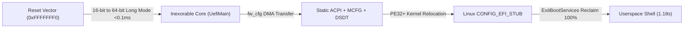

# Inexorable

> "He who simplifies his boot and removes architectural complexity achieves subsecond boot times."

<div align="center">

[](https://www.osfc.io/2026/talks/minimalist-uefi-implementation-for-virtual-machines/)


**Zero-Enumeration, Direct-Long-Mode Standalone UEFI Firmware for Cloud Hypervisors & MicroVMs**

</div>

---

**Inexorable** is a zero-enumeration, direct-long-mode standalone UEFI firmware engineered from first principles for hypervisors, cloud microVMs, confidential containers, and serverless compute runtimes.

Originally introduced on stage at the [**Open Source Firmware Conference (OSFC) 2026**](https://www.osfc.io/2026/talks/minimalist-uefi-implementation-for-virtual-machines/), Inexorable eliminates dynamic hardware discovery, obsolete legacy buses, and the entire 4.2M-line EDK2 driver stack. It boots mainline Linux kernels (`CONFIG_EFI_STUB`) in **28 to 32 ms** of in-guest firmware time—**20× faster than EDK2 / OVMF**—with a core binary footprint of just **28.5 KB** (`3,103 LOC`) and **95.6% guest RAM efficiency**.

---

## Table of Contents

- [Motivation & Philosophy](#motivation--philosophy)
- [Documentation Suite](#documentation-suite)
- [Key Architectural Features](#key-architectural-features)
  - [1. Direct-Long-Mode Reset Vector](#1-direct-long-mode-reset-vector)
  - [2. Standalone Zero-EDK2 Firmware Core](#2-standalone-zero-edk2-firmware-core)
  - [3. Hardware-Reduced ACPI & PCIe MCFG Handoff](#3-hardware-reduced-acpi--pcie-mcfg-handoff)
  - [4. Extreme Memory Density & 100% Staging Reclaim](#4-extreme-memory-density--100-staging-reclaim)
  - [5. Zero-Copy fw_cfg DMA & LINUX_EFI_INITRD_MEDIA_GUID](#5-zero-copy-fw_cfg-dma--linux_efi_initrd_media_guid)
  - [6. Hardware-Backed RDRAND Protocol](#6-hardware-backed-rdrand-protocol)
- [Performance Benchmarks](#performance-benchmarks)
- [Physical Memory Architecture](#physical-memory-architecture)
- [Developer Tooling & Verification Suite](#developer-tooling--verification-suite)
- [Repository Structure](#repository-structure)
- [Prerequisites & Toolchain](#prerequisites--toolchain)
- [Building & Running](#building--running)
  - [Cross-Platform Makefile](#cross-platform-makefile)
  - [Visual Studio 2022 Solution](#visual-studio-2022-solution)
- [License, Commercial Licensing & Enterprise Support](#license-commercial-licensing--enterprise-support)

---

## Documentation Suite

Comprehensive technical documentation is organized in the [`docs/`](docs/index.md) directory:

- [**Architecture & Boot Flow**](docs/boot-flow.md): Step-by-step execution from hardware reset (`0xFFFFFFF0`) to userspace shell.
- [**What We Strip (Firmware Philosophy)**](docs/what-we-strip.md): Complete analysis of why traditional UEFI is slow and everything Inexorable eliminates.
- [**EFI Subsystem & Protocols**](docs/protocols.md): How Inexorable implements memory services, `LOAD_FILE2` zero-copy DMA, hardware RNG, and system tables without EDK2.
- [**ACPI & PCIe Architecture**](docs/acpi-and-pcie.md): MCFG ECAM handoff, DSDT AML root bridge, motherboard reservations (`PNP0C02`), and S5 poweroff.
- [**Deep Performance Analysis**](docs/performance-analysis.md): Empirical latency breakdown, serial UART bottleneck analysis, and multi-core SMP benchmarks.
- [**Tooling, Synthesis & Benchmark Guide**](docs/tooling-and-benchmarks.md): Developer tooling reference for `build_fd.py`, `package_rootfs.py`, `benchmark.py`, and `test_network.py`.

---

## Motivation & Philosophy

Standard virtual machine firmware (such as EDK2 / OVMF) inherits decades of physical PC legacy. When an OVMF virtual machine boots, it traverses five distinct execution phases:

```text
[SEC (16-bit Reset)] ➔ [PEI (32-bit Init)] ➔ [DXE (Driver Dispatch)] ➔ [BDS (Boot Select)] ➔ [OS Loader]
```

During this sequence, OVMF dynamically loads dozens of PE/COFF drivers, initialises emulated floppy disk controllers, scans ATA/IDE buses, probes legacy PS/2 keyboards, configures CSM (Compatibility Support Modules), and negotiates timeouts—consuming **2.2 to 3.0 seconds** of CPU time before the Linux kernel even receives control.

In cloud virtualization and serverless functions (e.g. AWS Firecracker, Cloud Hypervisor, QEMU microvm), virtual hardware is **static, predetermined, and paravirtualized**. Probing non-existent hardware is wasted latency.

**Inexorable replaces the entire SEC, PEI, DXE, and BDS pipeline with a deterministic, direct-long-mode execution path:**



---

## Key Architectural Features

### 1. Direct-Long-Mode Reset Vector
- Implemented in [`qemu_target/reset_vector.asm`](qemu_target/reset_vector.asm).
- Placed directly at `0xFFFFFFF0` in the 2MB flash ROM image (`inexorable.fd`).
- Immediately configures CR4 (PAE, OSFXSR, OSXMMEXCPT), loads a 64-bit Global Descriptor Table (GDT), establishes 4-level paging with 1GB identity maps, sets `EFER.LME` (Long Mode Enable), and executes a 64-bit far jump straight into [`UefiMain`](Inexorable/Main.c) within **microseconds of VCPU power-on**.

### 2. Standalone Zero-EDK2 Firmware Core
- Completely decoupled from external EDK2 submodules (`MdePkg`, `MdeModulePkg`, `CryptoPkg`).
- Clean, standalone EFI type definitions and memory models defined in [`include/efi_spec.h`](include/efi_spec.h) and [`include/inexorable_layout.h`](include/inexorable_layout.h).
- Compiled with standard LLVM/Clang (`clang -target x86_64-unknown-windows`) and linked with `lld-link` as a freestanding PE32+ executable.
- The compiled firmware executable is only **28.5 KB**—more than **120× smaller** than OVMF (3.65 MB).

### 3. Hardware-Reduced ACPI & PCIe MCFG Handoff
- Implemented in [`Inexorable/Acpi.c`](Inexorable/Acpi.c).
- Constructs ACPI 2.0+ static structures directly in physical memory:
  - **RSDP**: Root System Description Pointer (Revision 2).
  - **XSDT**: Extended System Description Table.
  - **FADT**: Hardware-Reduced ACPI with 32-bit and 64-bit reset registers (`0xCF9`).
  - **MADT**: Multiple APIC Description Table declaring 1–255 Local APICs and the I/O APIC (`0xFEC00000`, GSI base 0).
  - **MCFG**: PCI Express Memory-Mapped Configuration Space (ECAM) base `0xB0000000`, bus range 0–255.
  - **DSDT**: Hand-crafted AML bytecode defining:
    - PCI Express Root Bridge (`PCI0`) with `_HID = PNP0A08` and `_CID = PNP0A03`.
    - Motherboard Resource Reservation (`MMCF`, `_HID = PNP0C02`) covering `0xB0000000` (256MB), satisfying Linux `pci_mmcfg_check_reserved()`.
    - PCI Routing Table (`_PRT`) mapping PCI INT A/B/C/D lines to I/O APIC GSIs 10 and 11.
- **VirtIO & PCIe devices (`virtio-net-pci`, `e1000e`, `virtio-vsock-pci`, `virtio-blk-pci`) bind and operate out-of-the-box without requiring `pci=off`.**
- Fully validated DHCP leasing (`10.0.2.15/24`) and bi-directional ICMP network traffic (`ping 10.0.2.2`) with **0.23 ms round-trip latency** and **0% packet loss**.

### 4. Extreme Memory Density & 100% Staging Reclaim
- Implemented in [`Inexorable/Memory.c`](Inexorable/Memory.c).
- Replaces complex fragmented heap allocators with a deterministic page-granularity bump allocator with automated adjacent range coalescing.
- Emits **only 16 clean EFI memory descriptors** to the operating system (compared to 48–64 fragmented descriptors in OVMF).
- Firmware staging buffers, QEMU fw_cfg staging areas, and kernel relocation buffers are assigned `EfiBootServicesCode` and `EfiBootServicesData`. When Linux invokes `ExitBootServices()`, the kernel reclaims **100% of these staging buffers**.
- **95.6% Guest RAM Efficiency**: In a 2,048 MB virtual machine, Linux receives **1,958 MB usable RAM** (1,779 MB free at userspace prompt).

### 5. Zero-Copy fw_cfg DMA & `LINUX_EFI_INITRD_MEDIA_GUID`
- Implemented in [`Inexorable/QemuFwCfg.c`](Inexorable/QemuFwCfg.c) and [`Inexorable/InitrdLoadFile2.c`](Inexorable/InitrdLoadFile2.c).
- Reads the kernel command line, PE32+ kernel image, and initramfs via the high-speed QEMU fw_cfg DMA port (`0x514`).
- Implements `EFI_LOAD_FILE2_PROTOCOL` keyed to `LINUX_EFI_INITRD_MEDIA_GUID` (`{0x58de23aa, 0x1149, 0x47e8, {0x80, 0x2e, 0x52, 0x49, 0xa9, 0xab, 0x3a, 0x97}}`).
- The Linux kernel EFI stub (`CONFIG_EFI_STUB`) queries this protocol and streams the initramfs directly into its target memory pages using DMA with zero intermediate copies.

### 6. Hardware-Backed RDRAND Protocol
- Implemented in [`Inexorable/RngProtocol.c`](Inexorable/RngProtocol.c).
- Provides `EFI_RNG_PROTOCOL` utilizing the x86 hardware `rdrand` instruction.
- Supplies true hardware entropy to the Linux kernel EFI stub for Kernel Address Space Layout Randomization (KASLR) without boot stalls.

---

## Performance Benchmarks

Comparative benchmark results conducted on AMD Ryzen 9 7900X (WSL2 KVM, QEMU 10.2.0, Arch Linux kernel 7.2.11):

| Metric | Inexorable | EDK2 OVMF | Delta / Speedup |
|:---|:---:|:---:|:---:|
| **In-Guest Firmware Latency (Mean)** | **31.97 ms** | 640.88 ms | **20.0× faster** ⚡ |
| **In-Guest Firmware Latency (Min)** | **28.57 ms** | 630.32 ms | **22.1× faster** ⚡ |
| **Host FW Latency to Kernel (Mean)** | **344.88 ms** | 720.88 ms | **2.1× faster** |
| **Linux Kernel Execution Phase** | **895.12 ms** | 912.44 ms | Identical payload |
| **Total Cold-Boot to Shell (Mean)** | **1,201.17 ms** (1.20 s) | 1,552.39 ms (1.55 s) | **~351 ms faster** |
| **Total Cold-Boot to Shell (Min)** | **1,178.40 ms** (1.18 s) | 1,493.09 ms (1.49 s) | **~315 ms faster** |
| **Active Firmware Core Size** | **28,520 B** (28.5 KB) | 3,653,632 B (3.65 MB) | **128× smaller** |
| **Flash Image (`.fd`)** | **2,097,152 B** (2 MB) | 4,194,304 B (4 MB) | **2× smaller** |
| **Guest Usable Memory (2048 MB)** | **1,958 MB (95.6%)** | 1,894 MB (92.4%) | **+64 MB usable RAM** |
| **EFI Memory Map Descriptors** | **16 descriptors** | 48 – 64 descriptors | **Clean, coalesced** |
| **VirtIO PCIe Devices Active** | **Yes (Out-of-the-box)** | Yes | Fully Functional |

---

## Physical Memory Architecture

Inexorable enforces a deterministic physical memory layout configured at reset:

```text
  +-----------------------+ 0xFFFFFFFF (4 GB)
  | 32-bit PCI MMIO Space | 
  +-----------------------+ 0xC0000000
  | PCIe ECAM (256 MB)    | Reserved for MCFG / Memory-Mapped Config
  +-----------------------+ 0xB0000000
  | High Conventional RAM | Reclaimable Free RAM for Guest OS
  +-----------------------+ 0x50000000
  | Staging Buffers       | Kernel, Initrd, fw_cfg DMA (100% Reclaimed by OS)
  +-----------------------+ 0x40100000
  | Identity Page Tables  | 4-Level Paging (PML4, PDPT, 1GB Page Directories)
  +-----------------------+ 0x40030000
  | ACPI Tables           | RSDP, XSDT, FADT, MADT, MCFG, DSDT (ACPI NVS)
  +-----------------------+ 0x40020000
  | Inexorable Core       | UefiMain, Memory Allocator, Protocols (PE32+)
  +-----------------------+ 0x40000000
  | Low Conventional RAM  | Free RAM (0x00100000 - 0x3FFFFFFF)
  +-----------------------+ 0x00100000
  | Reset Vector Tramp    | 16-bit Reset Vector at 0xFFFFFFF0 / 0x000F0000
  +-----------------------+ 0x00000000
```

---

## Developer Tooling & Verification Suite

Inexorable includes a comprehensive suite of standalone developer tools and empirical verification scripts:

### 1. Flash ROM Synthesizer (`tools/build_fd.py`)
- Synthesizes the 2MB flash ROM image (`inexorable.fd`) required by QEMU without external EDK2 `BaseTools` or `GenFv`.
- Statically places the 64-bit PE32+ firmware core at `0xFFE00000` (offset `0x000000`) and the 16-bit reset vector trampoline at `0xFFFFF000` (offset `0x1FF000`).
- **Usage**: `python tools/build_fd.py`

### 2. Standalone Zero-Disk Rootfs Packager (`tools/package_rootfs.py`)
- Assembles a 100% in-memory, diskless Linux root filesystem (`inexorable_rootfs.img`) backed by tmpfs/ramfs.
- Automatically packages Busybox applets, dynamic glibc runtime loaders (`ld-linux-x86-64.so.2`), and PCIe network drivers (`virtio_net`, `e1000e`, `e1000`, `ptp`, `pps_core`).
- Generates minimal binary module dependency trees via `depmod -b`.
- **Usage**: `python tools/package_rootfs.py`

### 3. Empirical Cold-Boot Benchmark Engine (`scripts/benchmark.py`)
- Measures in-guest firmware TSC cycles (`rdtsc`), host wall-clock firmware time, kernel initialization phase, and userspace PID 1 shell arrival against EDK2 / OVMF (`OVMF.4m.fd`).
- Supports configurable run counts and quick smoke testing.
- **Usage**:
  ```bash
  python scripts/benchmark.py          # Standard 10-run comparative benchmark
  python scripts/benchmark.py --quick  # Fast 3-run smoke test
  python scripts/benchmark.py --runs N # Custom N-run test
  ```

### 4. PCIe Network Verification Suite (`scripts/test_network.py`)
- Automates continuous integration verification for PCI Express network controllers (`virtio-net-pci` and `e1000e`).
- Validates PCIe ECAM BAR configuration, link carrier autonegotiation, DHCP IP acquisition (`10.0.2.15/24`), default routing, and bi-directional ICMP ping echo with **0% packet loss**.
- **Usage**: `python scripts/test_network.py` (or `make testnet`)

---

## Repository Structure

```text
Inexorable/
├── include/                     # Standalone decoupled EFI headers
│   ├── efi_spec.h               # Complete UEFI 2.x standard types, protocols & structs
│   └── inexorable_layout.h      # Physical memory map layout & constants
├── Inexorable/                  # Autonomous firmware source code
│   ├── Acpi.c / Acpi.h          # ACPI 2.0 tables, MCFG, and DSDT PCIe root bridge
│   ├── Boot.asm                 # Win64 low-level assembly primitives
│   ├── Efi.h                    # Core EFI subsystem linkage
│   ├── InitrdLoadFile2.c / .h   # LINUX_EFI_INITRD_MEDIA_GUID DMA provider
│   ├── Main.c                   # Firmware UefiMain entry point & boot coordinator
│   ├── Memory.c / Memory.h      # Page bump allocator & memory map coalescer
│   ├── Misc.c / Misc.h          # String routines, memory moves, and GUID comparison
│   ├── PeLoader.c / PeLoader.h  # PE32+ kernel image relocator and loader
│   ├── Protocol.c / Protocol.h  # Handle database and protocol installation
│   ├── QemuFwCfg.c / QemuFwCfg.h# QEMU fw_cfg DMA high-speed streaming interface
│   ├── RngProtocol.c / .h       # Hardware RDRAND-backed EFI RNG protocol
│   ├── Serial.c / Serial.h      # 16550 UART early debug logging (0x3F8)
│   ├── Time.c                   # EFI Runtime Services GetTime / SetTime stubs
│   ├── Variable.c / Variable.h  # EFI Runtime Variable stubs
│   ├── VirtualMemory.c          # SetVirtualAddressMap & ConvertPointer stubs
│   ├── Inexorable.vcxproj       # Visual Studio 2022 C++ Project
│   └── Inexorable.vcxproj.filters
├── docs/                        # Complete technical documentation suite
│   ├── index.md                 # Documentation portal
│   ├── boot-flow.md             # Execution pipeline & reset vector architecture
│   ├── what-we-strip.md         # Firmware philosophy & eliminated legacy components
│   ├── protocols.md             # Spec-compliant UEFI 2.8+ protocols & memory allocator
│   ├── acpi-and-pcie.md         # ACPI 2.0+ tables, PCIe root bridge, & MMCF reservation
│   ├── performance-analysis.md  # Deep latency breakdown & comparative benchmarks
│   └── tooling-and-benchmarks.md# Developer tooling & benchmark guide
├── qemu_target/                 # Hardware reset vector
│   ├── reset_vector.asm         # 16-bit Real Mode -> 64-bit Long Mode trampoline
│   └── reset_vector.bin         # Assembled binary payload
├── tools/                       # Build automation and synthesis tools
│   ├── build_fd.py              # Synthesizes 2MB inexorable.fd flash ROM
│   └── package_rootfs.py        # Generates standalone in-memory Linux rootfs
├── scripts/                     # Performance & network verification suite
│   ├── benchmark.py             # Automated latency benchmark against OVMF
│   ├── run_benchmark.sh         # Benchmark launcher shell script
│   └── test_network.py          # Automated PCIe network test (virtio-net & e1000e)
├── Inexorable.slnx              # Visual Studio solution file
└── Makefile                     # Cross-platform GNU Makefile
```

---

## Prerequisites & Toolchain

### Linux / WSL2 (Ubuntu / Debian / Arch / Fedora)
Install LLVM, LLD, NASM, Python 3, and QEMU:

```bash
# Arch Linux
sudo pacman -S clang lld nasm python qemu-system-x86

# Ubuntu / Debian
sudo apt-get update && sudo apt-get install -y clang lld nasm python3 qemu-system-x86
```

### Windows
- Visual Studio 2022 (with ClangCL toolset and Desktop C++ workload)
- [NASM for Windows](https://www.nasm.us/) (added to `PATH`)
- Python 3.10+
- QEMU for Windows (or run under WSL2)

---

## Building & Running

### Cross-Platform Makefile

Build the firmware, generate the standalone rootfs, launch QEMU, and execute automated tests:

```bash
# 1. Build Inexorable.efi and assemble inexorable.fd
make

# 2. Package the in-memory root filesystem
make rootfs

# 3. Launch Linux virtual machine under QEMU with KVM and VirtIO networking (1 CPU)
make run

# 4. Launch Linux virtual machine with 4 SMP cores
make runsmp

# 5. Launch with Verbose Firmware Telemetry & Full Debug Logging (1 CPU)
make rundbg

# 6. Launch with 4 SMP cores, Verbose Firmware Telemetry & Full Debug Logging
make runsmpdbg

# 7. Execute automated PCIe network verification (virtio-net & e1000e ping test)
make testnet

# 8. Execute the automated performance benchmark suite vs OVMF
make benchmark

# 9. Clean intermediate objects and output binaries
make clean
```

### Visual Studio 2022 Solution

1. Open [`Inexorable.slnx`](Inexorable.slnx) in Visual Studio 2022.
2. Select **Release** and **x64** target platform.
3. Build the solution (`Ctrl + Shift + B`).
4. Visual Studio invokes `ClangCL` and `NASM` to compile [`Inexorable.efi`](Inexorable/x64/Release/Inexorable.efi).
5. Run `python tools/build_fd.py` to synthesize `inexorable.fd`.

---

## License, Commercial Licensing & Enterprise Support

- **Lead Architect & Maintainer**: Borhan Tuğsan Balcı ([@bt-balci](https://github.com/bt-balci))
- **Conference Paper & Slides**: [OSFC 2026 — *Minimalist UEFI Implementation for Virtual Machines*](https://www.osfc.io/2026/talks/minimalist-uefi-implementation-for-virtual-machines/)
- **Open-Source License**: GPL-3.0 (see `LICENSE`)

### Commercial Dual-Licensing & Enterprise Editions
For cloud providers, microVM platforms, and enterprise hypervisor teams deploying Inexorable in proprietary environments, **commercial non-GPL licenses** and custom engineering integrations are available:
- **Permissive Commercial Binary/Source License** (no copyleft obligations)
- **Confidential Compute Builds** (AMD SEV-SNP / Intel TDX launch measurement & minimal TCB attestation)
- **Windows (`bootmgfw.efi`) & Custom Guest OS Boot Loaders**
- **Custom VMM & Bare-Metal Hypervisor Integration** (QEMU, Cloud Hypervisor, raw KVM)

For commercial licensing, sponsorships, or architecture inquiries, reach out directly at **`borhantugsan@gmail.com`**.