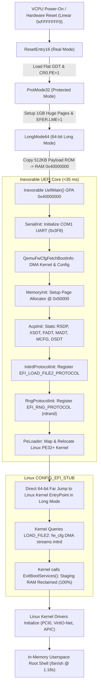

# Inexorable Architecture & Boot Flow

This document details the complete end-to-end execution pipeline of Inexorable from power-on hardware reset to Linux userspace.

---

## 1. High-Level Execution Pipeline



---

## 2. Phase 1: 16-Bit Real Mode to 64-Bit Long Mode Transition

Standard UEFI implementations start in Real Mode, transition to 32-bit Protected Mode for SEC and PEI, and only enter 64-bit Long Mode much later during DXE. Inexorable executes this entire transition within **microseconds** directly inside [`qemu_target/reset_vector.asm`](file:///C:/Users/Staarblitz/source/repos/Inexorable/qemu_target/reset_vector.asm).

### Reset Vector (`0xFFFFFFF0`)
When an x86 processor powers on or resets, execution begins at `CS:IP = F000:FFF0` (physical linear address `0xFFFFFFF0`).
1. **Disable Interrupts**: `cli` and `cld` ensure a deterministic execution state.
2. **Load Flat GDT**: Uses `lgdt [cs:gdtr]` referencing a pre-baked descriptor table embedded in ROM. All descriptors have the *Accessed* bit pre-set (`0x9B` and `0x93`) to prevent CPU write faults when running in read-only ROM mappings under hardware hypervisors (Intel VT-x / AMD-V).
3. **Enable Protected Mode**: Sets `CR0.PE = 1` and executes a 32-bit far jump to [`ProtMode32`](file:///C:/Users/Staarblitz/source/repos/Inexorable/qemu_target/reset_vector.asm#L99).

### 4-Level Identity Paging Construction
At `ProtMode32`, Inexorable establishes a 4-level paging hierarchy mapping the entire 4GB physical address space using **1GB huge pages**:
- **PML4** placed at `0x1000`. Entry 0 points to PDPT at `0x2000` (`Present | Writable = 0x03`).
- **PDPT** placed at `0x2000` with 4 entries of 1GB huge pages (`Present | Writable | PageSize_1GB = 0x83`):
  - `0x00000000 - 0x3FFFFFFF` (0 to 1 GB): Conventional Low RAM.
  - `0x40000000 - 0x7FFFFFFF` (1 to 2 GB): Inexorable Firmware Core & Staging Buffers.
  - `0x80000000 - 0xBFFFFFFF` (2 to 3 GB): High RAM & PCIe ECAM Window (`0xB0000000`).
  - `0xC0000000 - 0xFFFFFFFF` (3 to 4 GB): 32-bit PCI MMIO Space & Flash ROM (`0xFFE00000`).

### Long Mode Activation
- Sets `CR4.PAE = 1`, `CR4.OSFXSR = 1`, and `CR4.OSXMMEXCPT = 1`.
- Enables Long Mode in the Extended Feature Enable Register: `IA32_EFER MSR (0xC0000080)` bit 8 (`LME = 1`).
- Loads `CR3` with PML4 physical base `0x1000`.
- Enables paging: `CR0.PG = 1`.
- Executes a 64-bit far jump into [`LongMode64`](file:///C:/Users/Staarblitz/source/repos/Inexorable/qemu_target/reset_vector.asm#L167).

---

## 3. Phase 2: Firmware Payload Shadowing & Entry

Once running in 64-bit Long Mode:
1. **Stack Initialization**: Reloads 64-bit data selectors and points `RSP` to `0x00080000` (safe low conventional memory).
2. **Early UART Initialization**: Configures COM1 (16550 UART at port `0x3F8`) for 115,200 baud (divisor 1, 8N1, FIFO enabled) for early debug output.
3. **Payload Copy**: Copies the 512KB pre-mapped firmware payload from ROM (`0xFFE00000`) into RAM (`0x40000000`) using 64-bit `rep movsq`.
4. **PE Header Parsing & Dispatch**: Reads `e_lfanew` and `AddressOfEntryPoint` from the mapped PE32+ header at `0x40000000` and jumps directly into [`UefiMain()`](file:///C:/Users/Staarblitz/source/repos/Inexorable/Inexorable/Main.c#L18).

---

## 4. Phase 3: Hardware Discovery & Protocol Setup

Inside [`UefiMain()`](file:///C:/Users/Staarblitz/source/repos/Inexorable/Inexorable/Main.c#L18), Inexorable sets up the bare-metal EFI runtime:

### 1. High-Speed DMA via QEMU fw_cfg
- Probes port `0x510` for signature `"QEMU"`.
- Reads `FW_CFG_RAM_SIZE` (`0x0003`) to discover guest physical memory dynamically (e.g. 2048 MB).
- Streams the Linux kernel payload directly to GPA `0x40100000` using the QEMU fw_cfg high-speed DMA interface (I/O port `0x514`).
- Reads the kernel command line from `FW_CFG_CMDLINE_DATA` into memory.

### 2. High-Density Memory Manager
- Allocates a page allocation bitmap at GPA `0x00050000` (outside low BIOS memory).
- Marks low RAM (`0x00100000 - 0x3FFFFFFF`) and high RAM (`0x50000000 - EndOfRAM`) as `EfiConventionalMemory`.
- Marks kernel staging (`0x40100000`) and firmware temporary allocations as `EfiBootServicesData`, allowing the operating system to reclaim 100% of these pages upon handover.

### 3. Static ACPI 2.0+ Construction
- Directly populates physical memory at `0x40020000` with ACPI structures:
  - **RSDP** (`0x40020000`): ACPI 2.0 36-byte structure registered in `gST.ConfigurationTable` via `EFI_ACPI_20_TABLE_GUID`.
  - **XSDT** (`0x40021000`): Points to FADT, MADT, and MCFG.
  - **MADT** (`0x40022000`): Declares Local APICs for all active vCPUs and the I/O APIC (`0xFEC00000`).
  - **FADT** (`0x40023000`): Hardware-Reduced ACPI profile with PCI reset register `0xCF9`.
  - **MCFG** (`0x40024000`): Declares PCIe ECAM MMCONFIG window at `0xB0000000` across buses 0–255.
  - **DSDT** (`0x40025000`): Handcrafted AML bytecode defining PCIe root bridge `PCI0`, `_PRT` routing table, `PNP0C02` ECAM reservation, and `_S5` soft-off package.

### 4. Protocol Registration
- **`EFI_LOAD_FILE2_PROTOCOL`**: Registered with GUID `LINUX_EFI_INITRD_MEDIA_GUID` on handle `0x1000`. Provides zero-copy DMA streaming of `initrd` directly into kernel memory on demand.
- **`EFI_RNG_PROTOCOL`**: Registered with GUID `EFI_RNG_PROTOCOL_GUID` on handle `0x1001`. Backed by the hardware `rdrand` instruction to provide entropy for kernel KASLR.

---

## 5. Phase 4: PE Loader & Direct Long Mode Kernel Handover

1. **PE Parsing**: [`IxLoadPeImage()`](file:///C:/Users/Staarblitz/source/repos/Inexorable/Inexorable/PeLoader.c#L103) inspects the kernel image staged at `0x40100000`.
2. **Page Allocation**: Allocates contiguous pages of `EfiBootServicesCode` at GPA `0x00100000` matching `SizeOfImage`.
3. **Section Mapping**: Copies each PE section (`.setup`, `.text`, `.data`, `.rodata`) to its corresponding `VirtualAddress` using inline vectorized `rep movsb`.
4. **Relocation Processing**: Traverses `.reloc` base relocations (`IMAGE_REL_BASED_DIR64` and `IMAGE_REL_BASED_HIGHLOW`) and adjusts pointers relative to the allocated base.
5. **Loaded Image Protocol**: Installs `EFI_LOADED_IMAGE_PROTOCOL` on the kernel handle, binding the command line string and image base.
6. **Kernel Invocation**: Performs a direct 64-bit call in Long Mode to the kernel's `AddressOfEntryPoint`:
   ```c
   EFI_IMAGE_ENTRY_POINT KernelEntry = (EFI_IMAGE_ENTRY_POINT)(ImageBase + NtHeaders->OptionalHeader.AddressOfEntryPoint);
   KernelEntry(KernelHandle, &gST);
   ```

---

## 6. Phase 5: ExitBootServices & Total Memory Reclamation

1. During early boot, Linux's `CONFIG_EFI_STUB` queries `EFI_LOAD_FILE2_PROTOCOL` to stream the initial ramdisk via DMA straight into its target memory buffer (`0x7EFC1000`).
2. Linux invokes `GetMemoryMap()` to obtain the final memory layout (16 clean descriptors).
3. Linux invokes `ExitBootServices(KernelHandle, MapKey)`.
4. Inexorable invalidates Boot Services and returns `EFI_SUCCESS`.
5. Linux marks all memory of types `EfiBootServicesCode` and `EfiBootServicesData` as free RAM, **reclaiming 100% of the staging memory** used by Inexorable.
6. The Linux kernel boots into userspace, launching `/init` from tmpfs in **1.18 seconds**.
